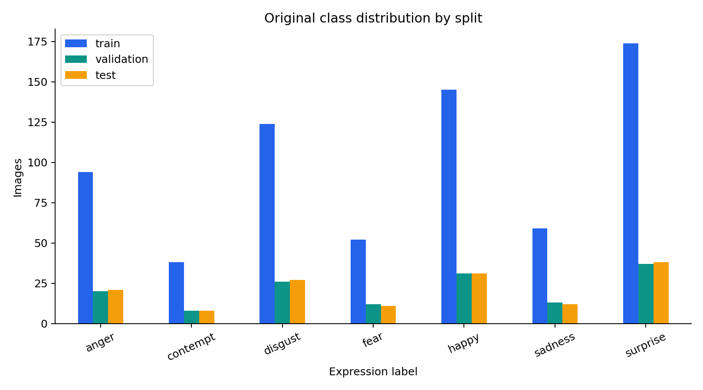

# Facial Expression Classification with Geometric Features

A reproducible machine learning study comparing a decision tree, support vector machine (SVM), and PyTorch multilayer perceptron (MLP) on **25 engineered facial features**. The original CS 471 team project explored whether facial geometry could support expression classification with compact models.

This portfolio version corrects feature calculations, makes the experiments reproducible, keeps scaling and class balancing inside cross-validation, and compares two evaluation strategies with generated metrics and figures.

**Evaluation scope:** the benchmark compares a stratified **image-level split** with a sensitivity analysis that keeps **inferred three-image groups** together. The groups are a hypothesis based on filenames and feature similarity. Original sequence and subject identities are unavailable, so neither evaluation establishes performance on unseen people or everyday photos.

[Benchmark results](docs/results.md) · [Data and feature definitions](docs/data.md) · [Coursework history](docs/coursework.md) · [LinkedIn project text](docs/linkedin.md)

## The experiment

The feature table contains distances, ratios, angles, and symmetry measurements for seven expression labels: **anger, contempt, disgust, fear, happy, sadness, and surprise**. The benchmark compares the three models against a dummy baseline and emphasizes **macro F1**, which gives each class equal weight.


Image extraction belongs to the original coursework. The runnable benchmark starts from the corrected feature table, which can also be regenerated from the committed landmarks.

## Results

See the [results overview](docs/results.md) for both reproduced model comparisons and their interpretation. Detailed reports, selected settings, and machine-readable metrics are saved with each run:

| Evaluation | Detailed report | Metrics |
| --- | --- | --- |
| Stratified image split | [results/report.md](results/report.md) | [CSV](results/metrics.csv) · [JSON](results/metrics.json) |
| Inferred-group sensitivity analysis | [results/inferred_sequence/report.md](results/inferred_sequence/report.md) | [CSV](results/inferred_sequence/metrics.csv) · [JSON](results/inferred_sequence/metrics.json) |




The SVM scores 0.9897 test macro F1 with image splitting and 0.6230 when inferred frame groups stay together; the MLP scores 0.9632 and 0.6570. This gap motivates checking related-frame dependence before claiming generalization.

The original report and notebook contain historical results from different runs. The generated report is the source for the portfolio benchmark's results.

## Run locally

Use **Python 3.12**. Clone this repository and open a terminal in its root.

Windows PowerShell:

```powershell
py -3.12 -m venv .venv
.\.venv\Scripts\Activate.ps1
python -m pip install torch==2.8.0 --index-url https://download.pytorch.org/whl/cpu
python -m pip install -r requirements.txt
python -m pip install -e .
python -m facial_expression.train --output-dir results
```

Linux:

```bash
python3.12 -m venv .venv
source .venv/bin/activate
python -m pip install torch==2.8.0 --index-url https://download.pytorch.org/whl/cpu
python -m pip install -r requirements.txt
python -m pip install -e .
python -m facial_expression.train --output-dir results
```

The default command uses seed `42` and regenerates an image-level split: **686 training, 147 validation, and 148 test samples**. Run the second evaluation with:

```bash
python -m facial_expression.train --split-strategy inferred-sequence --output-dir results/inferred_sequence
python -m facial_expression.report
```

This sensitivity analysis groups filenames of the form `Ck+_<emotion>_<index>.png` by expression label and `index // 3`. It keeps the resulting **327 groups of three** together during splitting and cross-validation, with **684 training, 147 validation, and 150 test samples**. These are inferred groups, not verified original sequence identifiers. See [the data notes](docs/data.md) for the evidence and limitations.

Hyperparameter searches learn preprocessing and any SMOTE resampling from each training fold. The test split remains separate from model selection. The MLP uses seeded PyTorch training.

To regenerate the corrected features from the archived landmarks:

```bash
python -m facial_expression.features
```

Install optional notebook and test dependencies with `python -m pip install -r requirements-dev.txt`.

For an interactive walkthrough, open [notebooks/benchmark.ipynb](notebooks/benchmark.ipynb) in the same environment. It displays saved results by default; set `RUN_BENCHMARK = True` to rerun the package from the notebook.

## Repository guide

| Path | Contents |
| --- | --- |
| `src/facial_expression/` | Benchmark implementation |
| `notebooks/benchmark.ipynb` | Notebook entry point |
| `data/features.csv` | Corrected features regenerated from all 981 committed landmark rows |
| `data/features_original.csv` | Byte-for-byte copy of the supplied coursework feature table |
| `results/` | Generated metrics, confusion matrices, and comparison figures |
| `docs/results.md` | Generated benchmark report |
| `archive/coursework/` | Original coursework code, notebook, report, slides, and data splits |

**Stack:** Python, NumPy, pandas, scikit-learn, imbalanced-learn, PyTorch, Matplotlib, and Jupyter. The original feature extraction used MediaPipe and OpenCV.

## Interpretation and limitations

- The data come from a small, controlled expression dataset with imbalanced classes. Image-level evaluation can be optimistic when related frames or the same person appear in multiple splits.
- Grouping by inferred triples tests sensitivity to likely frame relationships. It does not verify the original sequences or separate people between splits.
- Raw images are absent from this repository. The benchmark evaluates geometric features regenerated from stored landmarks; image-to-prediction inference has not been independently verified.
- Facial-expression labels describe visible expressions. They do not establish a person's internal emotional state.
- Feature definitions and preprocessing choices require attention when extending the project. See [docs/data.md](docs/data.md) for the corrections and [docs/coursework.md](docs/coursework.md) for the historical experiment.

## Authors and contributions

Originally completed for **CS 471: Artificial Intelligence, May 2025** by:

| Team member | Original contribution documented in the report |
| --- | --- |
| **Alexander Nicholas** | SVM implementation and GridSearchCV tuning; data/feature engineering; visualizations; code consolidation; report and slides |
| **Kieran Hawkins** | PyTorch MLP and Optuna tuning; report and slides |
| **Michael Duggan** | Decision tree implementation and GridSearchCV tuning; report and slides |

Alexander's subsequent portfolio improvements, assisted by Codex, add corrected feature calculations, the reproducible package, improved evaluation workflow, the inferred-group sensitivity analysis, generated reporting, and project documentation. Original team artifacts are preserved in [archive/coursework/](archive/coursework/), and their relationship to this version is explained in [docs/coursework.md](docs/coursework.md).

The coursework identifies the dataset as CK+ and cites [this dataset source](https://www.kaggle.com/datasets/shuvoalok/ck-dataset/data). Consult the source's terms for dataset reuse; code and dataset permissions are separate.
