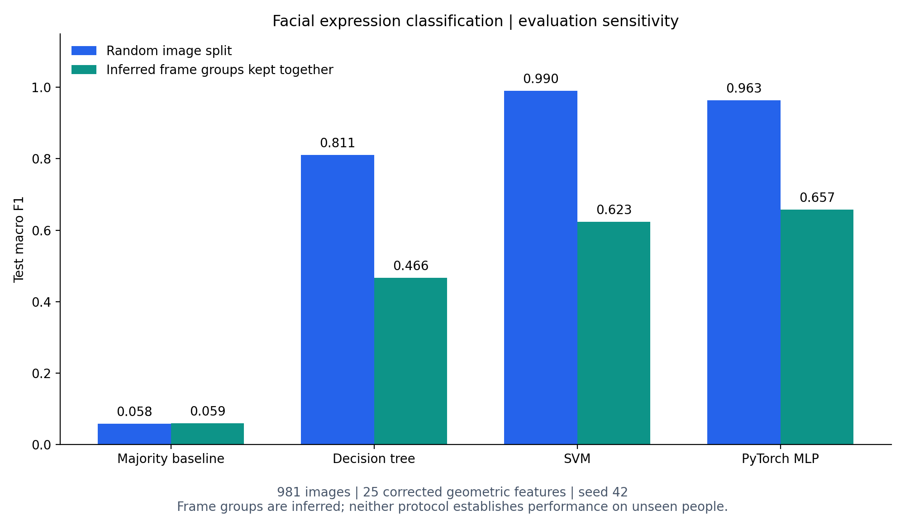

# Reproduced benchmark results

The portfolio benchmark compares classifiers using corrected feature schema version 2. Both runs use the same 981 images and seed 42. All model selection is completed before test predictions are computed.



| Model | Image split test macro F1 | Inferred-group test macro F1 |
|---|---:|---:|
| Majority baseline | 0.0584 | 0.0590 |
| Decision tree | 0.8105 | 0.4664 |
| SVM | 0.9897 | 0.6230 |
| PyTorch MLP | 0.9632 | 0.6570 |

## What the comparison means

The image split contains 127 inferred frame groups shared between training and test. The grouped run keeps each candidate group together in both the outer split and cross-validation. It also tunes models independently using that protocol's training/validation data. The difference is a sensitivity comparison across protocols, not a causal estimate on identical test images.

Groups are inferred from expression and filename index divided by three. They are not verified original sequence IDs and do not identify people. Neither score should be described as accuracy on unseen people or real-world emotion recognition. These are retrospective experiments on data already explored during the coursework; no fresh independent dataset was collected.

## Reproduction

```bash
python -m facial_expression.features
python -m facial_expression.train --seed 42 --output-dir results
python -m facial_expression.train --seed 42 --split-strategy inferred-sequence --output-dir results/inferred_sequence
python -m facial_expression.report
```

| Protocol | Train | Validation | Test | Classical CV |
|---|---:|---:|---:|---|
| Stratified image | 686 | 147 | 148 | Five stratified image folds |
| Inferred groups | 684 | 147 | 150 | Five stratified group folds |

Decision-tree and SVM searches maximize training cross-validation macro F1. Scaling and optional SMOTE are fitted separately in every fold. The MLP uses CPU training, 12 seeded Optuna trials (up to 200 epochs per trial), and validation macro F1 for tuning and stopping. Its final run allows 600 epochs and restores the best validation checkpoint. The MLP scaler and SMOTE use training rows only. Training scores use original images rather than synthetic samples. The validation metrics participate in model selection and are not independent performance estimates.

## Evidence

- [Image split detailed report](../results/report.md) and [metrics JSON](../results/metrics.json)
- [Grouped detailed report](../results/inferred_sequence/report.md) and [metrics JSON](../results/inferred_sequence/metrics.json)
- Split manifests, test predictions, search scores, per-class reports, and confusion matrices are saved beside each report.
- [Feature provenance and limitations](data.md) and [historical coursework comparison](coursework.md)

Dataset SHA-256: `a3ae3a5081cdef3096db9f4149c695ed42e2fbf1797c7395756ee8d3ce3a2ee5`.

Reproduction was verified locally on Python 3.12 using the package versions recorded in the metrics JSON files. PyTorch repeatability is targeted to the pinned CPU environment; numerical results can vary across platforms and dependency versions.
